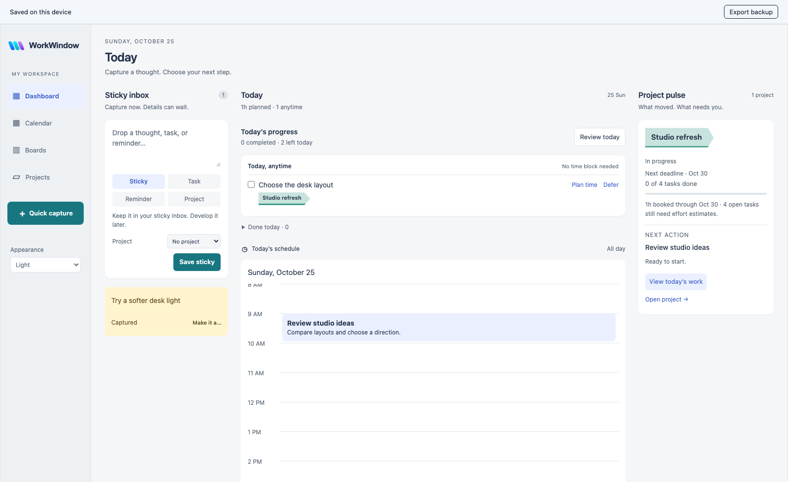
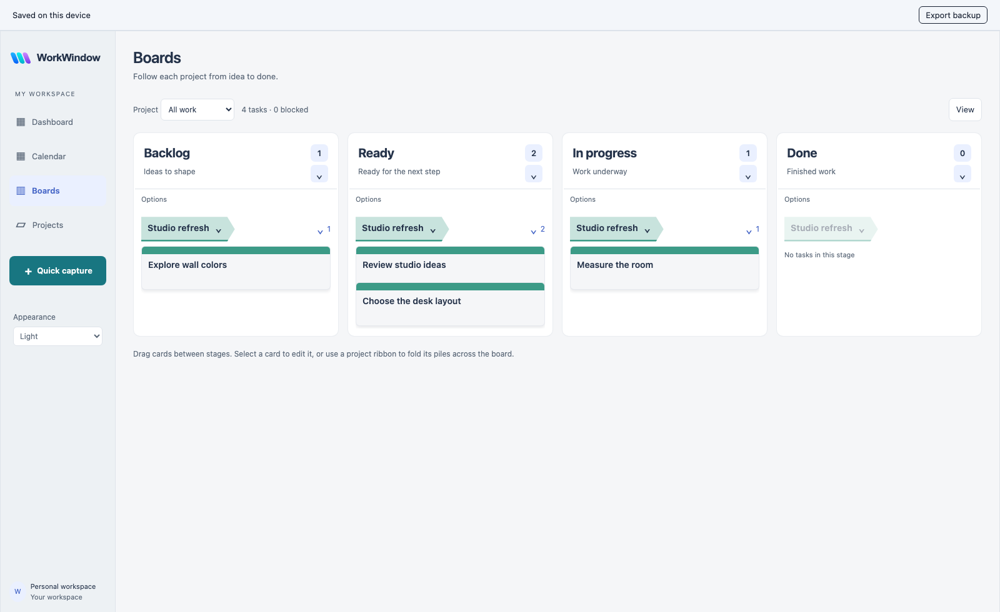

# WorkWindow

**Capture a thought → choose today’s work → do it → feel finished.**

WorkWindow brings quick capture, daily planning, Kanban boards, and projects into one browser workspace. A thought can stay a sticky note or become a task, reminder, or project immediately.

[Open WorkWindow](https://workwindow.vercel.app) · The hosted workspace requires an approved account. Run locally to explore an empty workspace without signing in.



## One workspace, four views

| View      | Purpose                                                                                                                     |
| --------- | --------------------------------------------------------------------------------------------------------------------------- |
| Dashboard | Capture thoughts, choose today’s tasks, see booked time, and complete or defer work.                                        |
| Calendar  | See month/week plans, drag across dates to create a WorkWindow, and book specific time blocks.                              |
| Boards    | Follow Backlog → Ready → In progress → Done with stacked project piles, shared project colors, and expandable task details. |
| Projects  | Review the timetable, next action, progress, blockers, tasks, and saved project notes.                                      |

A **WorkWindow** is a date range and estimated effort in hours. A **time block** reserves a specific start time and duration. Task details let you edit notes, blockers, dependencies, dates, and effort without leaving the board.



Screenshots use fictional fixtures isolated from production. New workspaces contain no sample tasks or projects.

## Run locally

Requires Node.js 24.x and npm.

```bash
npm ci
npm run dev
```

Without Supabase environment variables, the dashboard opens directly and saves to this browser. There is no mode chooser. Local data does not automatically sync or migrate into a cloud account.

For an authenticated deployment, follow [Cloud setup](docs/cloud-setup.md). The hosted app uses Supabase email magic links and stores owner-scoped workspaces in Postgres.

## Saving and privacy

- Local evaluation uses browser storage. Configured cloud deployments also keep a device cache, including unsynced edits.
- Cloud saves are serialized and checked against a revision number. A conflicting edit pauses saving instead of overwriting newer work; export the local draft before loading the saved workspace.
- Other sessions refresh from the cloud periodically and on window focus when no edits are pending.
- Export backup downloads workspace JSON. Treat exports as private; there is currently no redesigned import/restore interface.
- Upgraded legacy cards retain their original records. Legacy effort points are preserved as context, not converted to hours.

See [Privacy](PRIVACY.md) and [Security](SECURITY.md). Never put passwords, tokens, private exports, or server-side keys in this public repository. Vite environment variables are browser-visible; use only the Supabase URL and publishable key.

## Architecture

React/Vite provides the application shell and authentication. `src/redesign/Workspace.jsx` mounts the approved interface, `controller.js` handles view interactions, `model.js` validates and migrates workspaces, and `cloud.js` handles revision-checked persistence. The UI shares one workspace across all four tabs.

Older components in `src/components` and the reducer under `src/state` remain for legacy coverage and reference; they are not the redesigned UI entry point. This is an incremental migration, not a complete rewrite of every source module.

## Checks and contribution

```bash
npm run lint
npm run format:check
npm test
npm run build
npm run screenshots:install
npm run test:e2e
```

To regenerate the fictional README screenshots: `npm run screenshots:capture`.

CI runs formatting, lint, unit tests, build, browser/accessibility checks, and a full-history Gitleaks scan. See [Contributing](CONTRIBUTING.md) and [release notes](docs/REDESIGNED-RELEASE.md).

## Current scope

- Desktop browser use is primary; narrow layouts support basic phone review.
- Sticky notes and reminders live inside the app. Native floating notes and background push notifications are not implemented.
- No guaranteed offline capture/sync, installable-app support, automatic scheduling, or collaborative real-time editing.
- Light and dark appearances are tested. Automated accessibility checks complement, rather than replace, manual testing.
- Legacy insights, point-based planning, and import controls are not part of the redesigned interface.
